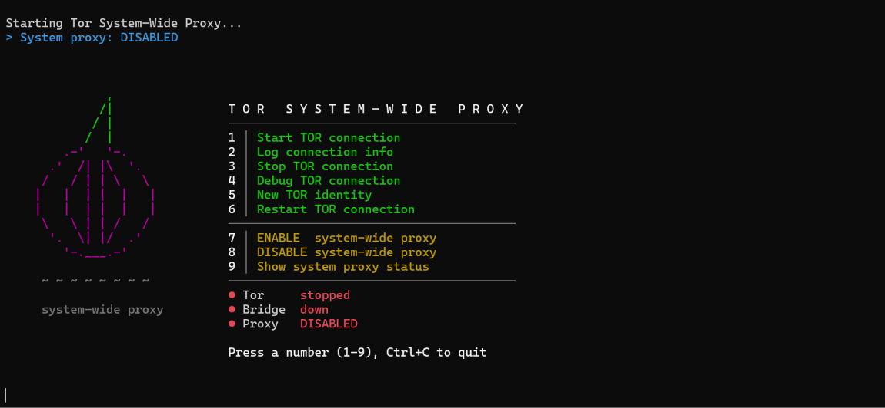

# Tor System-Wide Proxy



Route your computer's **system-proxy traffic** through the [Tor](https://www.torproject.org/) anonymity network. This project runs a local Tor client, exposes a SOCKS5 proxy, and switches your operating system's proxy settings on and off — with an interactive menu and a scriptable CLI.

Available for **Windows** and **macOS**.

> **Scope:** both versions change the *system proxy*, not the network stack. Apps that respect the system proxy (browsers, curl, most apps) are routed through Tor. Apps that bypass it are not covered — this is not a VPN and does not capture all system traffic.

## Attribution

This project was **built with parts of [onion-browser-button](https://github.com/jeremy-jr-benthum/onion-browser-button)** by **jeremy-jr-benthum** — the Tor proxy patch for the *Onion Browser Button* and *Browse with Onion* browser add-ons. The original project's Tor launcher concept, interactive control menu, `torrc` control-port setup, and `tor-control`-based commands (start/stop/restart, new identity, logs, debug) were used as the foundation, then heavily extended with:

- System-wide proxy enable/disable (Windows registry / macOS `networksetup`)
- An HTTP → SOCKS5 bridge for Windows
- Password-protected Tor control port (random per-run password)
- Backup & restore of your previous proxy settings
- Readiness checks (refuses to enable the proxy before Tor is up)
- Automatic cleanup on exit or Tor failure
- CLI mode and hardened process execution (no shell)

The upstream project states no license; credit and thanks to the original author.

## Repository layout

| Folder | Platform | Details |
|--------|----------|---------|
| [`Tor system-wide proxy/`](Tor%20system-wide%20proxy/) | Windows | [Windows README](Tor%20system-wide%20proxy/README) |
| [`Tor system-wide proxy macos/`](Tor%20system-wide%20proxy%20macos/) | macOS | [macOS README](Tor%20system-wide%20proxy%20macos/README) |

Each version is self-contained and can also be used/published on its own.

## Features (both versions)

- **Interactive menu** (9 options) and **CLI** (`start`, `stop`, `restart`, `newnym`, `logs`, `debug`, `proxy-on`, `proxy-off`, `status`, `help`)
- **Secure control port** — a random control password is generated on every start (hashed via `tor --hash-password`); no open control port
- **Safe enable** — the proxy is only enabled after verifying Tor is actually listening
- **Settings preserved** — your previous proxy configuration is saved before enabling and **restored** on disable, on exit, or if Tor dies
- **DNS through Tor** — hostnames are handed to Tor unresolved
- **No hard-coded secrets** — `tor-data/` (control password, keys, backups) is gitignored everywhere
- **MIT licensed**, with `package.json` / `package-lock.json` for the Node dependencies

## Platform differences

| | Windows | macOS |
|---|---|---|
| System proxy mechanism | `HKCU\...\Internet Settings` registry | `networksetup` per network service |
| Proxy protocol exposed to apps | HTTP via built-in bridge on **8118** → Tor SOCKS5 | Native SOCKS5 on **9050** |
| Admin rights | **Not required** (per-user registry) | `sudo -v` before proxy changes (per-command `sudo -n`) |
| Tor / Node source | `scripts\fetch-vendor.ps1` (SHA256-verified download) | `brew install tor node` |
| Launcher | `run.bat` | `run.sh` |

## Quick start

### Windows

```bat
cd "Tor system-wide proxy"
powershell -ExecutionPolicy Bypass -File scripts\fetch-vendor.ps1
npm install
run.bat
```

Press **1** (start Tor), wait for `100%`, press **7** (enable proxy). Press **8** to restore your previous settings, **3** to stop Tor.

### macOS

```bash
cd "Tor system-wide proxy macos"
brew install tor node
npm install
chmod +x run.sh
./run.sh
```

Press **1** (start Tor), wait for `100%`. Run `sudo -v` once, then press **7** (enable proxy). Press **8** to restore your previous settings, **3** to stop Tor.

## Ports

| Port | Purpose |
|------|---------|
| 9050 | Tor SOCKS5 proxy |
| 9051 | Tor control port (password-protected) |
| 8118 | HTTP → SOCKS5 bridge (**Windows only**) |

## Security & privacy notes

- The Tor control port requires a password and only listens on `127.0.0.1`.
- All external commands run via `execFile`/`execFileSync` — no shell interpretation.
- On Windows the whole tool runs without administrator rights; on macOS only the individual proxy changes use `sudo`.
- `AvoidDiskWrites 1` is set in `torrc` for extra privacy.
- **Warning:** disabling Tor while the system proxy is still enabled breaks connectivity. The tool guards against this automatically, but if it is force-killed, run `proxy-off` to restore your connection.
- This project is not affiliated with the Tor Project. Use Tor responsibly and read [Tor's safety guidance](https://www.torproject.org/download/download#warning).

## License

MIT — see the `LICENSE` file in each version's folder. Original launcher concept and Tor control code from [onion-browser-button](https://github.com/jeremy-jr-benthum/onion-browser-button) (jeremy-jr-benthum), used with attribution.
